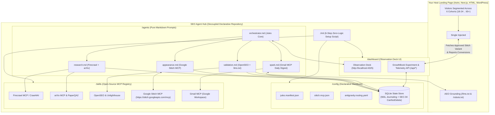

# SEO Agent Hub 🚀
> **Declarative Model Context Protocol (MCP) & GrowthBook Agentic Stack for Data-Driven Page Generation, AEO & A/B Testing**  
> *Powered by Jules Core, Google Stitch MCP, Firecrawl MCP, arXiv MCP, OpenSEO, SQLite MCP & Spark (Gmail MCP)*

[](#microsoft-waf-compliance)
[](LICENSE)
[](#architecture-topology)

---

## 🌟 Featured Real-World Reference Implementation

This module is live and battle-tested on the **[Pharos University Hemodialysis Digitization Portal](https://github.com/AhmedNasser-bug/Grad_project_landing)** (`Grad_project_landing`), an Egyptian Clinical Decision Support web portal supervised by **Dr. Mohamed Abdou** (Office of the Dean, Faculty of Computer Science & AI).

### How It Operates on the Dual Shield Hemodialysis Portal:
1. **Academic & Competitor Grounding**: The Research Agent scans competitor nephrology EHR pages (Firecrawl MCP) and PubMed / arXiv papers (arXiv MCP) extracting clinical AI safety data (e.g. MedGemma 2.5 CPOE prescription interception, 0.942 AUROC benchmarks, Guro Hospital hemolysis outbreak case studies).
2. **Data-Driven Page Generation**: Jules prompts Google Stitch MCP (`https://stitch.googleapis.com/mcp`) with the research insights to generate high-converting landing page variants and clinical articles matching the **Clinical Vitality** design system (`#FFFFFF` medical white, `#004AC6` primary blue, `#0B1C30` slate typography).
3. **SEO & AEO Validation**: OpenSEO and Unlighthouse audit generated pages (scoring **96/100**), updating `llms.txt` and `robots.txt` for AI answer engines (`GPTBot`, `Claude-Web`, `PerplexityBot`).
4. **GrowthBook Zero-Backend A/B Testing**: The host landing page loads a single `<script>` tag (`growthbook-ab.js`), which serves Stitch-generated page variants across the 6 demographic cohorts without changing the host codebase.
5. **Daily Spark Digest**: Spark compiles newly captured clinical leads from `/partner` and daily SEO action items, dispatching them to the lead investigator's inbox via Gmail MCP with `PeekLock` resiliency.

---

## 🏛️ System Architecture & MCP Registry



| System Layer | Legacy Custom Approach | Open-Source & MCP Replacement | Primary Operator |
|---|---|---|---|
| **Web Reconnaissance** | Custom scrapers | Firecrawl MCP or Crawl4AI | Antigravity / Jules |
| **Academic Discovery** | Custom API wrappers | arXiv MCP and PaperQA2 | Antigravity / Jules |
| **SEO & AEO Auditing** | Custom linters | OpenSEO, Unlighthouse, `llms.txt` | Validation Gate |
| **DOM & A/B Mutation** | Custom JS hydrator | GrowthBook JS SDK, Stitch MCP | Jules + Stitch |
| **Dispatch & Dashboard** | Custom web server | Gmail MCP, SQLite MCP, Chainlit | Spark and Jules |

---

## 🎯 Demographic Cohort Matrix (6 Target Cohorts)

| Cohort | Label & Tone | Primary Call to Action | Research & Differentiation Hook |
|---|---|---|---|
| **`18-24`** *(Primary Testing Cohort)* | Trainees, Medical Students & Residents (Academic, AI-Forward) | "Request Resident Pilot Access" | MedGemma 2.5 CPOE safety interceptor, 0.942 AUROC ML models, live outbreak simulators |
| **`25-34`** | Staff Nurses & Junior Clinicians (Workflow Ergonomics) | "View Bedside Workflow Integration" | Biometric bed queue, 4-hour machine timer, rapid visual charting |
| **`35-44`** | Unit Supervisors & Senior Nephrologists (Protocol Adherence) | "Request Unit Architecture Spec" | Ward-wide safety score, conductivity monitoring, HL7 FHIR compliance |
| **`45-54`** | Hospital Directors & Health IT Executives (Liability & ROI) | "Schedule Clinical Pilot Discovery" | Malpractice risk mitigation, water breach prevention ROI |
| **`55-64`** | Academic Deans & Ministry Evaluators (National Health Impact) | "Download Academic Whitepaper" | Egyptian national dialysis guidelines, Pharos University supervision |
| **`65+`** | Patient Advocates & Emeritus Consultants (Patient Dignity) | "Read Patient Protection Charter" | Gentle dialysis ultrafiltration, dry weight stabilization |

---

## 🚀 Quickstart: Fork & Inject in 2 Minutes

### Step 1: Fork and Clone the Repository
```bash
git clone https://github.com/AhmedNasser-bug/seo-agent-hub.git
cd seo-agent-hub
```

### Step 2: Configure Environment Variables
```bash
cp .env.example .env
# Edit .env with your credentials (or keep defaults for offline testing)
```

### Step 3: Run the Minimal Setup Script (`./init`)
```bash
./init
```
The `./init` script contains **zero business logic** and executes strictly six tasks:
1. **Jules Authentication**: Connects to your Google OAuth session.
2. **Stitch MCP Binding**: Binds `https://stitch.googleapis.com/mcp` directly to Jules.
3. **Optional Antigravity Handshake**: Binds `antigravity` if present, else defaults to `jules`.
4. **Agent & MCP Provisioning**: Prepares SQLite state store (`state/seo_hub.db`) and registers `/agents/*.md`.
5. **Spark Schedule Registration**: Sets up morning dispatch (`0 8 * * *`) for daily email digests.
6. **Dashboard & Proxy Launch**: Launches Observation Deck on `http://localhost:4325`.

### Step 4: Paste the Single `<script>` Tag into Your Landing Page
Paste this before `</body>` in your site's template (e.g. `Layout.astro` or `index.html`):
```html
<!-- SEO Agent Hub: GrowthBook A/B Testing & Stitch Page Variant Router -->
<script
  src="http://localhost:4325/sdk/growthbook-ab.js"
  data-api-host="http://localhost:4325"
  data-client-key="sdk-dual-shield"
  data-default-cohort="18-24"
  defer
></script>
```

---

## 🎛️ Observation Deck (`http://localhost:4325`)

Open `http://localhost:4325` in your browser to monitor and steer the entire stack:
- **Jules Orchestrator Terminal**: Type instructions in plain English (`research dialysis AI`, `generate cohort 18-24`, `approve 1`, `dispatch spark`).
- **Stitch Page Preview**: Side-by-side inspection of generated HTML pages with OpenSEO & Unlighthouse scores.
- **GrowthBook Cohort Matrix**: Real-time impressions, conversions, and traffic split controls across all 6 age cohorts.
- **Captured Leads**: Automatic form lead capture queue synced with Spark.

---

## 🛡️ Microsoft WAF Compliance (2025/2026 Standards)

- **`SEC-01` (Zero Hardcoded Secrets)**: Pure `.env` configuration.
- **`SEC-02` (SQL Injection Prevention)**: 100% parameterized SQLite prepared statements.
- **`SEC-04` (Delete Protection & Resource Locks)**: SQLite `CanNotDelete` triggers protect `leads`, `action_items`, and `generated_pages`.
- **`REL-01` (Mandatory Request Timeouts)**: Explicit `5000ms` `AbortSignal` timeouts on all network calls.
- **`REL-05` (Messaging Resiliency)**: `PeekLock` and Dead-Letter Queue (DLQ) state handling for email digests.
- **`REL-06` (Pool Isolation)**: Dedicated SQLite handles preventing read/write starvation.

---

## 🧪 Testing

Run the end-to-end integration test suite:
```bash
npm test
# or: node --test tests/e2e.test.mjs
```

---

## 📜 License
MIT License. Created by the Pharos University AI Engineering Team.
